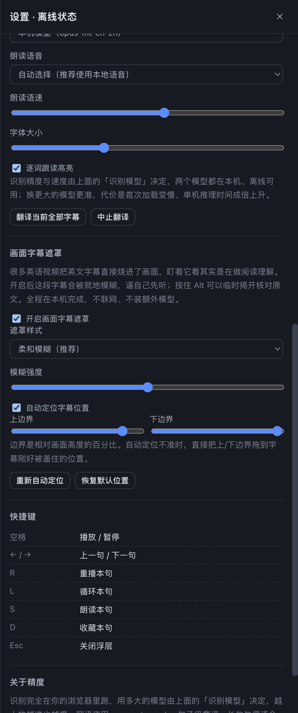
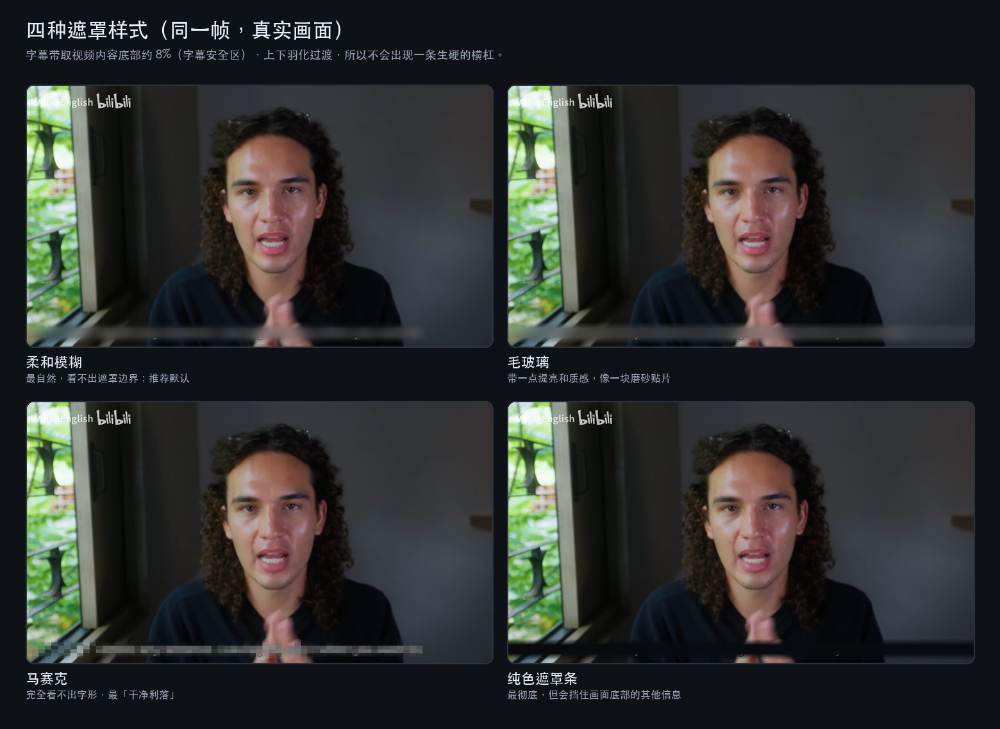
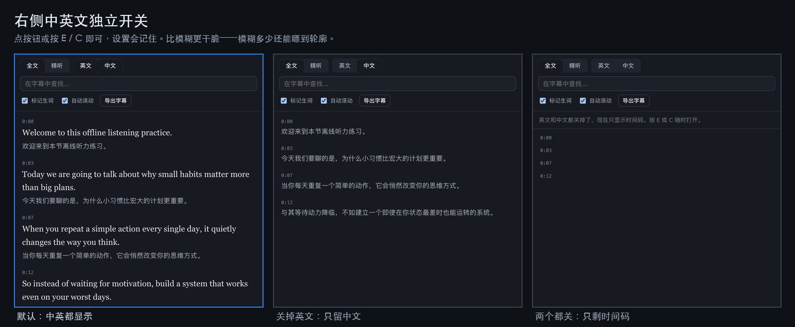
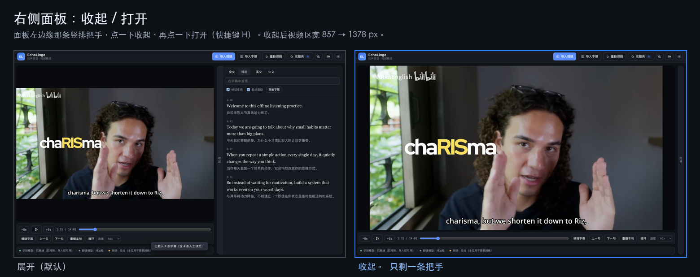

# EchoLingo · 回声英语

[](LICENSE)


外语视频精读工具。导入一段**英语或西班牙语**视频，自动识别每一句话，右侧显示原文与中文对照，**播放到哪个词，那个词就变浅绿**，像卡拉 OK 一样依次推进；点击任意单词查看释义与发音，整句可以朗读，句子和单词都能收藏。

界面支持**简体中文 / English / Español 三语切换**，配色提供**浅色 / 深色 / 跟随系统**三档。识别与翻译全部在浏览器本机完成，**视频不出本机，断网可用**。

---

## 界面

**画面烧录字幕遮罩** —— 很多英语视频把字幕直接烧进了画面，盯着它看其实是在做阅读理解。开启后这段字幕被就地模糊，画面其余部分完全不动；按住 `Alt` 临时揭开核对原文。

| 效果：左=关闭 · 右=开启 | 设置面板 |
| --- | --- |
|  |  |

四种遮罩样式可选，**柔和模糊**为默认：

| 四种样式的取舍 | 原始分辨率细节对比 |
| --- | --- |
|  |  |

**右侧中英文可分别收起** —— 练听力时不想被英文剧透就关掉英文；点按钮或按 `E` / `C`：



**整个字幕面板也能收起来** —— 纯听时把视频放到最大，`H` 或点面板边缘的把手：



---

## 四种打开方式

**① 打包成 Mac App**（推荐，最省事）

装好之后是启动台/Spotlight 里的一个普通应用，双击即用，模型随包带着，连首次要下模型这一步都省了：

```bash
cd desktop && node build.mjs     # → ../dist/EchoLingo.app
open ../dist/EchoLingo.app
```

**② 在线直接用**（只想用、不想装）

打开分享链接即可，无需安装任何东西。视频仍然只在你自己的浏览器里处理，不会上传。

**③ 本机双击启动**（macOS，不打包）

双击 `start.command`。

**④ 手动起服务**（开发 / 局域网）

```bash
node server.js          # 生产模式，监听 $PORT，带 COOP/COEP 头
python3 tools/serve.py 8765 --open   # 开发模式，自动打开浏览器
```

`server.js` 与 `tools/serve.py` 都会发送 `Cross-Origin-Opener-Policy` / `Cross-Origin-Embedder-Policy` 两个响应头。浏览器看到这两个头才会开启 `SharedArrayBuffer`，onnxruntime 才能用多线程跑推理。少这两个头不会报错，只会悄悄退化成单线程，识别时间成倍上升。

> 不要直接用 `file://` 打开 `index.html`。ES 模块、WebAssembly 和离线缓存都要求 http 环境。

---

## 三步上手

1. 点「载入示例音频」听一段 17 秒的英文，或把任意视频拖进左侧区域。
2. **识别自动开始**，不需要再点任何按钮。右侧会一句一句地冒出来，左下方进度条显示分段进度。
3. 点播放，**右侧的单词会跟着语音一个接一个变成浅绿色**，正在说的那个词颜色更深。点任意单词看释义，点句子里的按钮重播原声或朗读。

识别完成后顶栏按钮会变成「重新识别」，想重跑一遍就点它。不想自动识别的话，在设置里取消勾选「导入视频后自动识别」。

想跳过识别过程，可以点「载入示例字幕」，直接走人工字幕链路；即使在识别途中导入，人工字幕也会立刻接管。

顶栏右侧三个按钮分别是**配色主题**、**界面语言**（中 / EN）、**设置**。主题与语言的选择会记住，下次打开还是你选的那套；没手动选过主题时跟随系统。

---

## 功能

| 能力 | 说明 |
| --- | --- |
| 视频导入 | mp4 / mov / mkv / webm / mp3 / m4a / wav，文件用 blob URL 加载，全程不离开本机 |
| 自动识别 | 导入即开始，无需点击；识别在独立 Worker 里跑，界面全程可操作 |
| 边识别边显示 | 每识别完一段就地把结果拼句并渲染到右侧，长视频从第一段就能开始看 |
| 语音识别 | 浏览器内跑 whisper 量化模型，输出逐词时间戳，再按标点与停顿重组为句子。**英语用 `.en` 专用版，西语用多语言版**（`.en` 模型是纯英语训练的，喂西语只会得到无意义的猜测且不报错），Base / Tiny 两档 |
| 逐词跟读高亮 | 播放时按词的起止时间把右侧单词依次染成浅绿，当前词更深；没有逐词时间戳的素材（人工字幕）按词长比例自动分摊 |
| 字幕导入 | srt / vtt / txt / json，自动拆分同一条里的中英双语；导入即中断正在进行的识别 |
| 双语对照 | 右侧逐句显示英文与中文，随播放高亮并自动滚动 |
| 画面字幕遮罩 | 把**烧录进画面**的英文字幕就地模糊掉，逼自己先听。用 `backdrop-filter` 让合成器去糊背后的像素，不复制视频帧、不逐帧重绘；位置按 `object-fit: contain` 的换算实时计算，黑边、窗口缩放、面板收起都会跟着重算。四种样式：柔和模糊 / 毛玻璃 / 马赛克 / 纯色遮罩条 |
| 字幕自动定位 | 播放中**静默采样**（不打断观看，攒够帧数再回填位置），或点「重新自动定位」跳着抽 14 帧扫全片。逐行累计横向梯度、与首帧的差异、行内方差三个特征，只看画面下半部，置信度不够就保留默认位置；也可以手动拖上/下边界 |
| 中英独立收起 | 右侧英文与中文可分别隐藏（`E` / `C`）。用容器 class 切换而不是重建 DOM —— 识别时每 500ms 就要重排一次字幕，切 class 是零成本 |
| 面板收起 | 整个右侧面板收成 26px 的竖排把手（`H`），视频区宽 857 → 1378px；状态记在设置里，刷新后仍保持 |
| 中英界面 | 全部界面文案双语，一键切换并记住，动态生成的内容（字幕列表、收藏夹、状态栏）同步重建 |
| 浅色 / 深色 | 两套完整配色（含深色滚动条、悬停态、单词卡、抽屉），另可跟随系统；首屏前就定好主题，不会白闪一下再变黑 |
| 单词卡片 | 音标、中文释义、词性、英文释义、词形还原、在原文中的例句；可朗读、可收藏 |
| 句子朗读 | 系统本地语音合成，可调语速与音色；也可重播该句的原声片段 |
| 精听模式 | 只保留当前句，配上一句／重播／慢速／下一句按钮 |
| 收藏夹 | 生词与句子两个清单，支持搜索、导出 JSON、导入合并 |
| 快捷键 | 空格播放暂停，← → 切句，R 重播，L 循环，S 朗读，D 收藏，`E` / `C` 收起英文／中文，`H` 收起面板，`Alt` 临时看画面字幕原文，Esc 关闭浮层 |
| 离线 | Service Worker 缓存应用外壳，模型与词典走缓存优先；点「全部缓存到本机」一次到位 |

---

## 实测数据

在 macOS + Chromium 上实测（10 核，crossOriginIsolated）：

| 素材 | 结果 |
| --- | --- |
| 17 秒示例音频 | 解码 → 识别 4 句 → 翻译，合计约 2 秒（模型已预热） |
| 4 分钟英文音频（60 句） | 识别 12.5 秒，翻译 8.4 秒，合计约 21 秒 |
| 30 秒真实 MP4（412×456 视频轨 + AAC 音轨） | 画面正常解码播放，音轨识别与翻译照常完成 |
| **14 分钟 1080p MP4（842 秒）** | **识别 42 秒 + 翻译 26 秒 = 68 秒，258 句** |

同一素材在改造前的成绩是识别 76 秒 + 翻译 35 秒 = 111 秒。**提速约 1.7 倍**，准确度没有任何变化（并行分片不改变词的拼接结果）。

### 速度是怎么提上去的

先用真实语音把每一段推理拆开量，量出两条硬事实：

1. **每段有约 1.6 秒的固定开销。** whisper 的特征提取器窗口固定 30 秒，所以一段
   5 秒的音频和一段 29 秒的音频，编码器要做的工作量**一模一样**。总时间几乎正比于
   **段数**，而不是音频总长度。
2. **wasm 多线程帮不上大忙。** 实测 1 线程 RTF 0.205、4 线程 0.091 —— 只有 2.25 倍，
   因为 whisper 的 d_model 只有 512，矩阵一小，线程同步开销就占了大头。

于是方向就清楚了：**别在一个会话里堆线程，而是开多个会话并行分摊固定开销。**

| 配置 | 真实语音 RTF | 说明 |
| --- | --- | --- |
| 1 会话 × 4 线程 | 0.091 | 改造前的水平 |
| 2 会话 × 4 线程 | 0.066 | |
| **4 会话 × 2 线程** | **0.058** | **现用配置，最优** |
| 5 会话 × 2 线程 | 0.060 | 装载开始互相拖累 |
| 6 会话 × 1 线程 | 0.063 | |

配套还做了两件事：

- **切段更长了。** 过去只挑「最安静的点」下刀，刀口常年落在 15–20 秒处；现在评分
  同时看「安不安静」和「够不够靠后」，14 分钟视频的段数从 **38 段降到 31 段**，
  固定开销直接省掉近两成。
- **翻译也并行。** 句子之间彼此独立，2 个线程并行逐句翻译（仍然 batch = 1，
  见下方约束），翻译时间从 35 秒降到 26 秒；顺便把推理挪出了主线程。

4 分钟音频那一次，右侧字幕按段逐步出现：0 → 14 → 16 → 29 → 37 → 54 → 60 句，全程主线程保持 60fps，没有出现界面卡死。

14 分钟那一次共 258 句 / 2100 词，字幕区 4400+ 个节点，播放期间仍稳定 59.9 fps，无卡顿；逐词跟读与点词开卡片都正常。

关闭本机服务器后重新打开页面，上述链路依旧完整跑通，结果是同一份。

---

## 离线边界（重要，请如实理解）

先说结论：**这个工具从头到尾不需要互联网。** 识别模型、翻译模型、词典、wasm 运行时全都是项目目录里的本地文件，由 `start.command` 起的本机服务器提供，请求根本不离开 `127.0.0.1`。

真正需要分清的是两个不同层面：

| 层面 | 说明 |
| --- | --- |
| 互联网 | 从不使用。装好之后拔网线、关 Wi-Fi 都能跑 |
| 本机服务器 | 需要 `tools/serve.py` 在跑。因为浏览器不允许 `file://` 加载 ES 模块与 WebAssembly |
| 浏览器缓存 | 可选。点「全部缓存到本机」后，连本机服务器都不需要了；直接开浏览器就能用 |

所以离线能力是有梯度的：只要本机服务器在跑，就完全不依赖互联网。想连服务器都不启动，就额外做一次缓存。浏览器缓存可能被系统清理，清掉之后重新启动一次服务器即可恢复。

视频文件本身从不写入磁盘以外的任何地方，也不经过网络。页面用的是 `blob:` URL，文件数据只活在当前标签页的内存里。

### 在线版和本机版是同一份东西

在线分享链接和本机跑的是完全相同的文件，唯一区别是文件从公网取。**第一次**识别或翻译时浏览器需要下载模型（Whisper Base 约 80 MB / Tiny 约 44 MB，翻译模型约 120 MB），之后由 Service Worker 缓存，再打开就很快，拔网线也能继续用。视频依旧只在你自己的浏览器里处理，不上传。

部署时请用 `node server.js` 而不是普通的静态托管：前者会发送 COOP/COEP 头，让推理跑满多线程。

---

## 精度说明

**识别。** 内置两个模型，在设置里切换：

| 模型 | 体积 | 14 分钟视频实测 | 适合 |
| --- | --- | --- | --- |
| **Whisper Base (EN)** 默认 | 约 80 MB | 识别约 80 秒 | 俚语、连读、口音词明显更准 |
| Whisper Tiny (EN) | 约 44 MB | 识别约 50 秒 | 配置较低的机器 |

差距是实打实的。同一个 14 分钟俚语视频，Tiny 把 `you're cooked` 听成 `your coach`、`rizz` 写成 `res`；Base 全部正确。所以默认用 Base，慢一点但值得。

加第三个模型不需要改代码：把模型目录放进 `models/`（保持与现有目录相同的文件结构），刷新页面它就会自动出现在下拉框里。清单在 `js/models.js`，只有本机真实存在的模型才会被列出来。

两者都只认英语，这是 `.en` 模型的硬限制。遇到口音极重、多人抢话的素材仍会掉字。

**翻译。** 内置 opus-mt 系列量化模型，句子级机器翻译，能读但不是人话，长句、俚语、文化梗经常跑偏。它只是帮你快速抓住大意，精读请以原文为准。

⚠️ **西班牙语是两跳翻译**：HuggingFace 上根本不存在现成的「西→中」ONNX 量化模型（搜过，没有；NLLB 那种直译模型量化后要 1.7 GB，不现实）。所以西语走 `opus-mt-es-en` → `opus-mt-en-zh`，先译成英文再译成中文。代价是翻译慢一倍、误差会累积（偶尔出现「欢迎欢迎」这类重复），而且两个模型要同时驻留内存。

有一处坑值得记下：这个翻译模型在**批处理**时会失控。padding 之后一起解码，短句会被强制解码到上限，输出整段重复加未知符（实测四句批处理耗时 4.9 秒且全是废话，逐句解码 0.7 秒且完全干净）。所以 `js/mt.js` 里刻意保持一次一句。改这块的时候别顺手加 batch。

**字幕。** 如果手头有人工字幕（尤其是双语字幕），导入 srt 得到的结果永远优于识别加翻译。这条路径没有模型误差，是这套工具里最准的用法。

---

## 六条必须守住的硬约束（改代码前先看这段）

### 一、每一段音频都必须短于 30 秒

whisper 的特征提取器窗口固定 30 秒。`vendor/transformers.min.js` 里的实现是：

```js
e.length > s ? (console.warn(...), n = e.slice(0, s)) : (n = new Float32Array(s), n.set(e))
```

**超出的部分是静默裁掉的**，不报错、也不自动分块（除非显式传 `chunk_length_s`，本项目没有传）。所以切段一旦超过 30 秒，那一段的后半截就凭空消失。

这个坑最早就是按 42 秒切段踩到的：14 分钟的视频只识别出前 30/42 的内容，约 25% 音频被丢掉，字幕上下文接不上、结尾整段缺失，看起来像「识别错了」。

现在 `js/segment.js` 里 `MAX_SEG_SEC = 29`（留 1 秒余量就够，窗口是 30.0 秒），并且在 `clampSegments()` 里再兜一层：**任何超过 29 秒的段都会被硬切开**，保证这个不变量不会被后人改参数改坏。

### 二、推理必须跑在 Worker 里

识别推理全部跑在 `js/asr-worker.js` 这个 Worker 里。这样做不是为了架构好看，而是必需的：onnxruntime 的 wasm 后端在 `proxy=false` 下是**同步阻塞**的，如果放在主线程，一段二十几秒音频的推理就会让界面冻结一两秒，长视频会连续冻结几十次，字幕也没机会渲染出来。

分工是这样的：

| 文件 | 职责 | 运行位置 |
| --- | --- | --- |
| `js/asr.js` | 音轨解码 + Worker 客户端 + 主线程兜底 | 主线程 |
| `js/asr-worker.js` | 消息协议：load / run / cancel | Worker |
| `js/asr-engine.js` | 切段、推理、逐词清洗（纯计算，无 DOM） | Worker（兜底时主线程） |

`asr-engine.js` 刻意不碰 DOM 与 WebAudio，所以两边都能加载。音轨解码必须留在主线程，因为 `OfflineAudioContext` 只在 window 上有。

切换素材或导入人工字幕时，主线程把任务代号 `S.asrRun` 加一，并向 Worker 发 `cancel`。推理不会被打断，但当前段做完就会停下，因此 `asr-engine.js` 的循环在每段之间有一次 `setTimeout(0)` 让出——Worker 靠它接收取消消息，主线程兜底模式靠它重绘界面。去掉这个让出会同时破坏取消与渐进显示。

### 三、每一次等 Worker 都要有超时，而且请求要排队

`js/asr.js` 里所有发往 Worker 的请求都带**空闲超时**：Worker 超过阈值（装载 5 分钟 / 识别 3 分钟）一条消息都不回，就判定卡死，终止它并把错误抛给调用方，界面如实报错。

没有这层保护时踩过一次：模型文件损坏导致装载失败，界面永远停在「正在装载模型…」，不报错也不结束。

请求还必须是**串行排队**的（`ask()` 里的 `chain`）。Worker 同一时刻只处理一个请求，以前是「有请求在跑就直接拒绝」，于是开机预热和用户点的识别撞在一起时，后到的那个会被 `已有识别任务在进行中` 弹回来 —— 用户明明点了按钮却什么都没发生。现在排队执行：先到的装载完，后到的发现模型已在内存就直接跑。

错误分两类，**分类错了会双重下载**：
- `transport`（Worker 启动失败、卡死被终止、无响应）→ 静默回退主线程；
- 普通错误 → 如实抛出。**装载阶段的「下载失败」（`network` / `fetch`）属于普通错误**，绝不能当成 Worker 不可用：那样会在主线程把几十 MB 模型再下一遍，首次使用要干等两轮。这类错误会先自动换一个干净的 Worker 重试一次，仍失败才上报。

回退主线程之前一定先 `terminate()` 掉 Worker，否则两套 onnxruntime session 同时占内存，主线程连音轨解码都会卡住。

### 四、Service Worker 的升级路径（改 `sw.js` / 缓存相关代码前必读）

线上老用户是从旧版本升上来的，这条路径比「首次安装」更容易出事。踩过的坑：

**`install` 里不能等待下载。** 原来写的是 `await Promise.all(SHELL.map(cache.add))` 之后才 `skipWaiting()`，外壳里含 1MB+ 的 `transformers.min.js`，只要有一个请求慢，install 就长期停在 `installing` —— `skipWaiting` 永不执行、`activate` 永不触发、旧缓存永不清除，新版本永远装不上。现在 `install` 里第一件事就是 `skipWaiting()`，预缓存改成后台 fire-and-forget。

**页面与代码一律 `network-first`，只有不可变大文件用 `cache-first`。** 以前 js/css 走 stale-while-revalidate，升级时会先交付新版 `app.js` 而 `index.html` 还是旧的，形成**「新 JS + 旧 HTML」**：新脚本找不到新元素，启动阶段直接 `Cannot read properties of null (reading 'addEventListener')`，页面半死不活、按钮全失效。network-first 保证在线时整站同版本。

**两层保险**：`index.html` 内联 `window.__ECHOLINGO_VER__`，`app.js` 里的 `APP_VER` 必须与它相同 —— 不一致就自动重载一次（`sessionStorage` 打标记防循环）；新 Worker 通过 `controllerchange` 接管时也自动补一次刷新，用户不必自己「刷两遍」。这两个值要一起改。

另外，`sw.js` 的 network-first 分支里**必须带 `cache: 'no-cache'`**。少了它，浏览器可能直接拿本地 HTTP 缓存的旧 `app.js` 回来，于是又出现「新 HTML + 旧 JS」，甚至更隐蔽的「新 `asr.js` + 旧 `asr-worker.js`」—— 后者的消息协议只写在代码里，对不上不会报错，只会静默失效。

### 五、识别是「多会话并行分片」，动它之前先看这段

主路径已经不是「一个 Worker 从头跑到尾」了，而是 `js/asr-pool.js` 起 **4 个会话 × 2 线程**，
把切好的段分给它们并行跑。几条不能破的规矩：

- **段与段必须互不重叠** —— 这是「并行结果与串行结果完全一致」的前提，也是这条优化
  敢上的底气。切段逻辑住在 `js/segment.js`，它零依赖：主线程要用它，而主线程
  **绝不能**因此把 1MB 的 `transformers.min.js` 拉进首屏。
- **每一段都必须短于 30 秒**（同第一条）；段内偏移由 Worker 自己加上，主线程拿到的
  词已经是全局时间。
- **装载必须先起一个、再起其余。** 同一批模型文件被 N 个会话并发请求时浏览器不会自动
  合并，首次使用会把几十 MB 下 N 遍。首次还有一层 `prefetchBig()` 在前面（见第六条）。
- **池子大小按设备来**（`pickPoolShape`）。每个会话要独立持有一份权重（base 约 77 MB），
  内存小或核数少的机器要自动降级，不能见到多核就开满。
- **同一模型只允许一个装载任务在飞**（`ensurePool` 里的 `poolPromise`）。开机预热和用户
  点识别几乎同时到达，少了这层单飞就会白建一个池子，多占几百 MB，还会把进度搅乱。
- **进度只按「已完成且连续」的前缀回调。** 各段并发返回，谁先跑完不一定谁在前面；
  谁先完成就先渲染谁，字幕会跳着往外冒。
- **准备换切段参数时，记得先重新量一遍。** 段变少 = 省固定开销，但下刀太靠后容易
  切在词中间；`tailBias` 就是这两者的权衡旋钮。
- **翻译预热分两步**：先只把文件拉进缓存（纯网络，可以和识别并行），建 ORT 会话推到
  系统空闲时再做 —— 那一步吃满 CPU，和识别撞上能让识别慢掉近两成。**但这整件事都只在
  「上次就缓存过识别模型」时才发生**，见第六条。

**`server.js` 给非不可变资源发 `no-cache` + `ETag`**：有验证器才能走 304，既保证「文件一改立刻看到新的」，又不必每次重传。

---

### 六、首次访问的带宽只给识别模型

这一条是拿线上实测数据换来的，改预热策略（`preloadModels` / `maybePreloadMT` / `prefetchBig`）前请先看完。

**站点侧是限速的，而且是按连接限的。** 同一台机器用 curl 量：

| 来源 | 单连接 | 4 并发 | 8 并发 |
| --- | --- | --- | --- |
| EchoLingo 自建站点 | 409 KB/s | 601 KB/s | **1108 KB/s** |
| 淘宝镜像（本机网络上限，对照） | — | — | 3.5 MB/s |

瓶颈在站点这一侧而不是用户：并发能拿到约 2.7 倍，所以**该并发的地方要并发**。

**首次访问原本要下 200MB。** 识别模型 80MB（encoder 23MB + decoder 54MB + 词表 4MB），
翻译模型 113MB（encoder 53MB + decoder 60MB）。旧代码里这两笔是**无条件连着下**的：
80MB 下完紧接着 113MB。按 400 KB/s 算就是八分钟起步 —— 用户报的「十几分钟甚至半小时」，
根子在这里，不在推理速度。

现在的规矩：

1. **首次访问只下识别模型。** 翻译模型推迟到「识别模型已在缓存里」的下一次访问，
   或者用户真的点了翻译时。`maybePreloadMT()` 里那几个条件都是有理由的，别顺手删：
   `transMode === 'off'` 是用户根本不用翻译；`asrWasCachedAtBoot` 必须取**开机时的快照**
   （在 `startModelJob` 成功之后这个标记就被写上了，那时再问就永远是「已缓存」）；
   `saveData` / `2g` `3g` 是弱网别雪上加霜。
2. **两个大 onnx 用并发连接预取。** `prefetchBig()` 在起会话之前把 encoder / decoder
   两条连接同时铺开，各自读到尾（读完才进缓存），后面所有会话都命中缓存。
   transformers 自己是顺序拉的，等于全程只有一条连接在跑，白白浪费可用的并发度。
   预取失败不算致命 —— 直接放行，让它走老路。
3. **进度按字节报，并且给剩余时间。** 下一遍 80MB 要几分钟，一个只会从 0% 爬到 100%
   的百分比条在这几分钟里和卡死没有区别。`loadProgressText()` + `paceEta()` 就是这个用途。
4. **`warmupFiles()` 里 `await fetch()` 不等于下完。** 它只等到响应头，响应体是后台流式
   进来的，循环会立刻跑到下一个文件 —— 十个文件（113MB）其实是同时铺开的。
   必须把 body 读完这条循环才真的是「一个一个来」。这个坑踩过一次，注释留在 `js/mt.js`。

**本地验证（冷 profile，14 分钟视频，258 句）：**

| 指标 | 关掉并发预取 | 开启并发预取（现用） |
| --- | --- | --- |
| 识别模型装载 | 4749 ms | **1969 ms** |
| 识别 | 62839 ms | 45144 / 49835 / 53100 ms |
| 各会话对两个 onnx 的请求 | 走网络 | **命中缓存，0.0 MB** |

顺手也给识别耗时做了 A/B（用 `BENCH_INIT_JS` 在页面脚本前写一个缓存标记来关掉预取）：
关掉之后识别**并没有变快**，反而是最慢的一次。这台机器上识别耗时的天然波动就有 45–63 秒，
**别拿单次结果下结论**。

---

## 目录结构

```
english-video-reader/
├── index.html                 主页面（界面文案全部挂 data-i18n，不写死在 JS 里）
├── server.js                  生产用零依赖静态服务器（带 COOP/COEP，监听 $PORT）
├── package.json               npm start → node server.js
├── css/styles.css             样式：所有颜色走 CSS 变量，浅色/深色各一套
├── js/
│   ├── app.js                 主控制器：自动识别编排、播放跟随、逐词跟读、渲染、收藏、主题
│   ├── i18n.js                中英词条表 + t()/applyI18n()
│   ├── models.js              识别模型清单 + 本地可用性探测
│   ├── segment.js             静音感知切段（零依赖，主线程与 Worker 共用）
│   ├── asr.js                 并行池客户端 + 音轨解码 + 超时看门狗 + 主线程兜底
│   ├── asr-pool.js            并行识别池：按设备定会话数、装载、派段、取消
│   ├── asr-worker.js          单个识别会话的消息协议（load / seg / run / cancel）
│   ├── asr-engine.js          whisper 推理本体（主线程/Worker 共用）
│   ├── mt.js                  离线翻译：并行分发 + 主线程兜底 + 文件预热
│   ├── mt-worker.js           单个翻译会话
│   ├── dict.js                词典懒加载与词形还原
│   ├── subtitle.js            srt/vtt 解析、逐词时间戳拼句与跟读时间轴
│   ├── tts.js                 本地语音合成
│   └── util.js                通用工具
├── vendor/                    transformers.js 与 onnxruntime wasm 运行时
├── models/
│   ├── whisper-base.en/       识别模型，默认（约 80 MB）
│   ├── whisper-tiny.en/       识别模型，备选（约 44 MB）
│   ├── opus-mt-en-zh/         英→中翻译模型（约 120 MB）
│   ├── opus-mt-es-en/         西→英翻译模型（约 120 MB，西语两跳的第一跳）
│   ├── whisper-base/          多语言版识别模型（约 80 MB，用于西班牙语）
│   └── whisper-tiny/          多语言版识别模型（约 44 MB，用于西班牙语）
├── dict/                      离线词典，34000 词条 / 按首字母分片
├── media/                     示例音频与示例字幕
├── tools/
│   ├── serve.py               本地开发服务器（带 COOP/COEP 头）
│   └── build_dict.py          从 ECDICT 重建 dict/ 目录
└── sw.js                      Service Worker
```

---

## 逐词跟读是怎么做出来的

`js/subtitle.js` 的 `groupWordsIntoSentences()` 在拼句时会把每个词的起止时间一起存进 `cue.words`。渲染时 `wordSpansHTML()` 把句子拆成一堆 `<span class="w">`，而 `wordTimings(cue)` 负责给出与这些 span 一一对应的时间轴：

- 有 whisper 逐词时间戳（且数量与分词结果一致）→ 直接用真实时间；
- 没有（人工字幕、纯文本，或长视频关闭了逐词时间戳）→ **按词长比例把整句时长分摊到每个词**，这样任何来源的字幕都能跟着播放逐词推进。

`js/app.js` 里由 rAF 循环调用 `updateKaraoke(time)`，二分（线性）找到当前词序号后交给 `paintKaraoke(mark, spoken)`：`spoken` 之前的词加 `.said`（浅绿），`mark` 那个词加 `.now`（深一档）。只在序号变化时才动 DOM；检测到跳转（拖动进度条、换句、回退）就整段重刷，避免残留。

右侧列表与纯音频时的大字区各是一组节点，两组同步推进。关掉设置里的「逐词跟读高亮」即可完全停用。

---

## 重建词典

`dict/` 里的内容是离线可用的，不需要联网。想换词表或调整规模：

```bash
curl -L -o ecdict.csv https://raw.githubusercontent.com/skywind3000/ECDICT/master/ecdict.csv
curl -L -o lemma.en.txt https://raw.githubusercontent.com/skywind3000/ECDICT/master/lemma.en.txt
python3 tools/build_dict.py ecdict.csv lemma.en.txt dict
```

脚本会做几件必要的事：按 BNC/COCA 词频筛掉生僻词，把 ECDICT 混用的西里尔字母与希腊字母音标统一成标准 IPA，压掉领域标记，并生成词形还原表（`habits` → `habit`）。词形还原优先用词典自带的 `exchange` 字段，官方 lemma 表只作补充且必须通过屈折规则校验，避免把 `they` 归到 `it` 这种错误。

---

## 桌面版（macOS）

把整站打包成 `.app`，双击即用、完全离线（553MB，其中模型 237MB，站点不联网也能跑）。

核心思路：Electron 主进程里起一个本地 HTTP 服务，页面从 `http://127.0.0.1` 加载。**这一步是必须的，不是图方便** —— onnxruntime 的 wasm 后端要多线程就得有 `SharedArrayBuffer`，而浏览器只在 `crossOriginIsolated` 成立时放开它，条件正是文档响应带 COOP/COEP 头。`file://` 给不了响应头，Chromium 里自定义协议也拿不到跨源隔离，只有 `http://127.0.0.1`（潜在可信来源）能同时满足「发得了头」和「注册得了 Service Worker」。

### 打包

```bash
cd desktop
node build.mjs              # → ../dist/EchoLingo.app
open ../dist/EchoLingo.app
```

**零依赖**：只要系统有 `node` 和 macOS 自带的 `ditto` / `plutil` / `codesign`。首次会下 Electron 的 zip（124MB，镜像优先、失败回退 GitHub），缓存在 `desktop/.electron-cache/`，之后重建是秒级。

### 为什么不用 @electron/packager

packager 依赖 `@electron/get` → `@electron-internal/extract-zip`，后者是 napi-rs 原生模块。在 macOS 27 上加载它会被系统的库校验直接拒绝：

```
dlopen(...index.darwin-universal.node): code signature ...
not valid for use in process: mapping process and mapped file
(non-platform) have different Team IDs
```

Node 进程和那个 `.node` 的 Team ID 不一致，系统不允许加载 —— `electron` 的 postinstall（解压）和 packager（解压）都会失败。而 zip 本身的**下载**是好的，所以 `build.mjs` 干脆不依赖任何 npm 包：自己 `fetch` 下 zip → `ditto` 解压 → 手工组装 bundle → `codesign` ad-hoc 重签。

> Apple Silicon 上 ad-hoc 重签不能省：往 bundle 里塞了东西之后 Electron 官方签名必然失效，而签名无效的 arm64 应用会被系统拒绝启动。

### 几个刻意的设计

- **端口固定 8731**（被占用才顺延到 8732…）。localStorage / IndexedDB（收藏夹）和 Service Worker 缓存都是按来源隔离的，端口一变用户的收藏就没了 —— 所以不能图省事用随机端口。
- **`backgroundThrottling: false`** —— 用户很可能切去别的窗口干等。默认的后台节流会把定时器压到 1 秒一次，进度回调和段间调度都会跟着变慢。
- **`asar: false`** —— 模型和 wasm 本来就是已压缩的二进制，asar 没有体积收益；而 240MB 的 onnx 从归档里流式读取更慢、也更容易出问题。
- **关窗即销毁渲染进程** —— 4 个识别会话占的内存随之还回去。

### 另一套打包路线

仓库里还留着一份 `electron/` + 根 `package.json` 的 electron-builder 配置（`npm run dist` 出 dmg）。思路相同，但走 packager，在本机受上面那个原生模块问题限制；要用的话先 `pnpm install` 把依赖装回来。**实际发布走的是 `desktop/build.mjs`。**

更多细节（含 `ELECTRON_RUN_AS_NODE` 这个环境坑）见 [`desktop/README.md`](desktop/README.md)。

---

## 已知限制

- 音轨解码会把整段 PCM 读进内存。16 kHz 单声道下约每分钟 1.9 MB，90 分钟以上会明显吃内存，超过 90 分钟会给出提示。
- 逐词时间戳默认开启。设置里可以关掉换成「更快」模式，那时句子时间轴按长度摊分（估算值）。实测逐词只比不要时间戳贵约 13%，而句子边界和跟读高亮都依赖它，所以长视频反而更需要开着。
- 画面字幕遮罩的位置靠自动检测：分析画面下半部的文字行。字幕在画面上半部、或视频压根没有烧录字幕时，检测会放弃并保留默认的底部 8%，此时请手动拖上/下边界。极少数视频字幕位置会来回变（例如中英双行交替出现），固定的一条带可能盖不全。
- 推理跑在 Worker 里，界面在识别期间保持可操作；但推理仍占用若干 CPU 线程（本机 4 个），长视频期间风扇会转。
- 取消只在段落边界生效。点了「重新识别」或换了素材，最长要等当前那一段（约 28 秒音频）跑完才会真正停下。
- 收藏存在 IndexedDB 里，清除浏览器数据会一起清掉。重要内容记得导出 JSON。
- 词典 34000 词条覆盖日常与常见书面语，专业术语可能查不到。查不到时卡片会明确说明，而不是给一个错误答案。
- 识别只支持**英语和西班牙语**。素材里出现中文、日语、法语等其他语言时，输出会是一串无意义的猜测。
- **模型语言必须和视频对上**：英语视频选 (EN)、西语视频选 (ES)。选错了不会报错，只会得到一串看起来像目标语言、实际毫无意义的句子。
- 西班牙语的翻译经由英文中转（见上文「精度说明」），比英语多一道损耗，也更慢。
- 识别模型再大也救不了所有素材：背景音乐重、多人抢话、口音极重的片段仍会出错。这类内容建议直接导入人工字幕。

---

## 许可与致谢

- 词典数据：ECDICT，MIT License，skywind3000/ECDICT
- 识别模型：whisper-base.en / whisper-tiny.en（英语）与 whisper-base / whisper-tiny（多语言，用于西语），均为 Xenova 的 ONNX 量化版本
- 翻译模型：opus-mt-en-zh、opus-mt-es-en（Xenova 的 ONNX 量化版本）
- 推理运行时：transformers.js、onnxruntime-web
